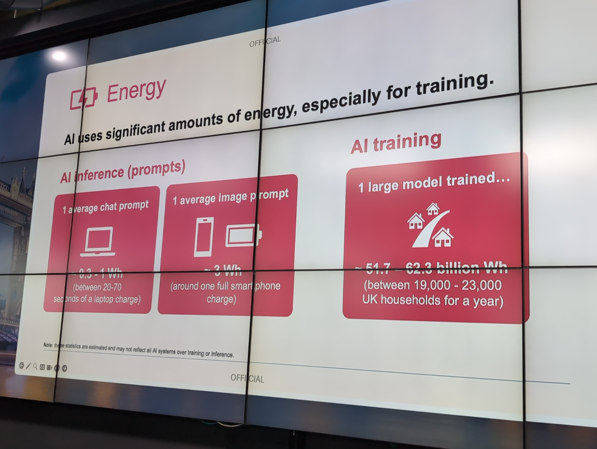
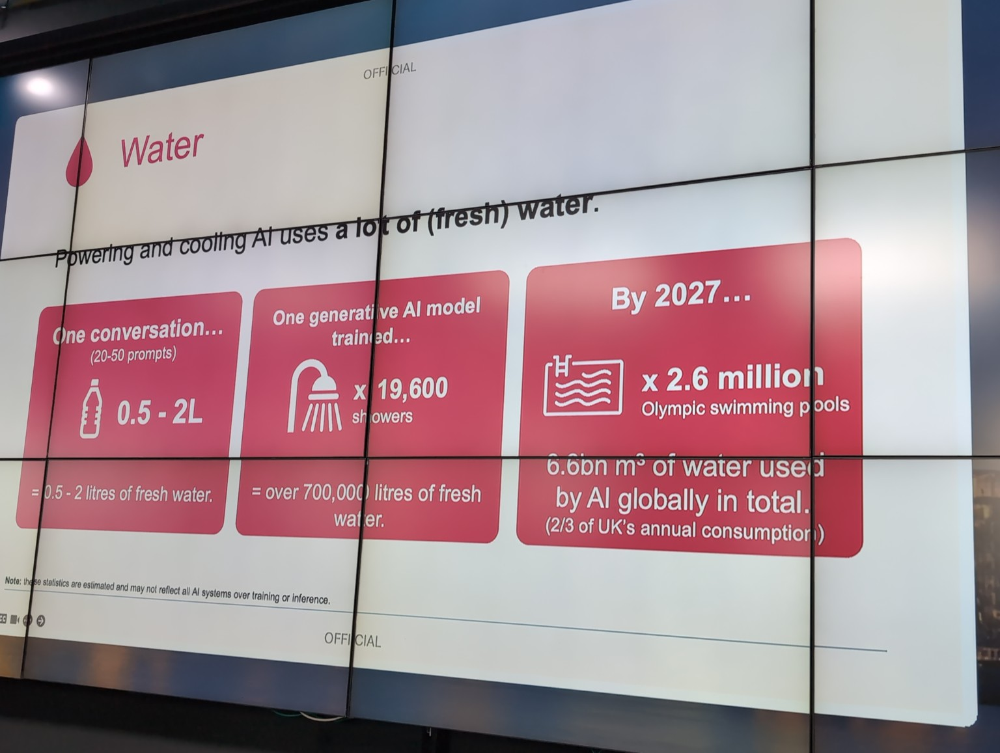
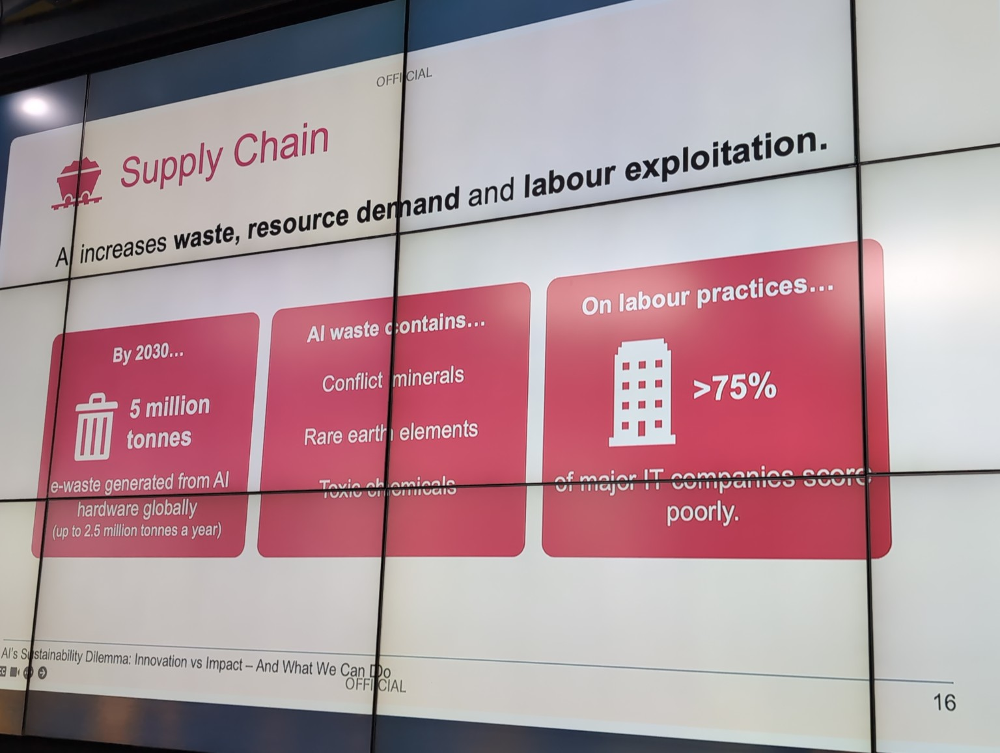

# AI sustainability slides for the IREA hackathon

Observed on 20 November 2026. This record assesses earlier presentation
material for the [xGov AI CoP Hackathon property
challenge](eventbrite-listing.md#challenge). The photographs came from a
ChatGPT slide-review conversation; they are not organiser materials. The date
and exact deck used in the earlier presentation have not been independently
confirmed.

## What was found

| Item | Observed content | Status |
| --- | --- | --- |
| AI Presentation, account-linked source reviewed 31 July 2026 | A three-slide text outline compares earlier worries about washing-machine water and detergent with current questions about AI data-centre water use. It also discusses possible technical responses and Plato's account of Thamus and writing. | The conversation contains an outline. Its request for a PowerPoint was not fulfilled there; no presentation file was attached. The historical comparison has no verified source in the conversation. |
| Slide assessment feedback, account-linked source reviewed 22 July 2026 | Three photographed slides address AI energy, water and supply-chain impacts. A subsequent ChatGPT response critiques their figures and labels. | The three original photographs are retained below. Their relationship to the washing-machine outline or the recalled presentation is unconfirmed. |

A search of local presentation files and the connected SharePoint and Canva
indexes did not identify a finished deck for the washing-machine outline.
Those searches are not proof that no deck exists elsewhere. The ChatGPT links
may require access to the original account and should not be treated as public
source URLs.

## Original slide photographs

The [image manifest](ai-sustainability-slides/manifest.json) records each
download name, size and SHA-256 checksum. These are byte-identical copies of
the ChatGPT attachments. The source photographs are retained separately from
any future edited versions.

### Energy

### Water

### Supply chain

## Recovered three-slide outline

The July conversation proposes: (1) a washing-machine analogy about water and
detergent concerns and later efficiency, chemistry and regulation; (2) a slide
asking how cooling, electricity supply and efficient computing could address
AI's impact; and (3) an analogy with Thamus's warning about writing in Plato's
*Phaedrus*. These are summaries of a proposed talk, not a recovered slide deck.
The first slide's historical premise still needs a source.

## Water slide: evidence check

The photographed water slide gives figures for a conversation, one model's
training and a global 2027 total. The [paper cited in the slide review, version
5](https://arxiv.org/html/2304.03271v5), supports narrower statements:

| Photographed slide | Paper's stated scope |
| --- | --- |
| 0.5–2 litres for a 20–50-prompt conversation | About 500 ml of estimated water consumption for roughly 10–50 medium-length GPT-3 responses, varying by place and time; the 2-litre upper value is not established there. |
| Over 700,000 litres for “one generative AI model” trained | About 700,000 litres of estimated direct evaporation for GPT-3 training in specified Microsoft US data centres. |
| 6.6 billion cubic metres of water “used” by AI globally in 2027 | A projection of **4.2–6.6 billion cubic metres of water withdrawal** in 2027. Withdrawal and consumption are different quantities. |
| “Two-thirds of the UK's annual consumption” | The paper compares its projected range with about half of UK annual **water withdrawal**; the UK comparison has not been independently checked here. |

These are modelled estimates and a projection with defined scope, not generic
meter readings for any current AI service.

The washing-machine comparison is a presentation idea. Before reusing it as
evidence, identify a historical source for the claim, define the water quantity
for each technology, and compare like units, periods and geographies. The
photographed slide's figures should be corrected and sourced before reuse.

## Relevance to the hackathon aims

The organiser asks teams to combine the Government Property Estate dataset
with other public data, explore estate performance, energy efficiency and
retrofit opportunities, prioritise buildings for investigation, and
communicate evidence that supports decisions. The day is for collaborative
learning and team showcases, with no formal judging. These are the aims
recorded in the [organiser's listing](eventbrite-listing.md#challenge).

For IREA, the photographs can introduce a practical evidence rule for a
prototype or showcase: label each quantity as measured, estimated or
projected; give its unit, period, geography, scope, source revision and
uncertainty. Keep water withdrawal distinct from water consumption, and
electricity use distinct from carbon emissions. Apply the same discipline to
property performance and retrofit suggestions. This is a proposed use of the
slides, not an extra requirement from the organiser.

The photographs do not contain property-estate data or establish any building
priority. The water slide needs correction before its figures are presented
as evidence. The energy and supply-chain slides require their own source
checks. The washing-machine outline can serve as a discussion prompt once its
historical premise is sourced.

## Access and rights

The ChatGPT conversations are account-linked records. The photographs show an
“OFFICIAL” marking. The user explained on 20 November 2026 that this was the
minimum classification on the protected system used for the demonstration,
and authorised use and modification of the images in this IREA repository.
The photographer confirmed that the three photographs are theirs and expressly
approved public publication on 20 November 2026. The public edition includes
the originals with attribution. This permission does not verify slide claims
or grant a blanket reuse licence. No people appear in the photographs, and
an EXIF, GPS, IPTC and XMP check found no such metadata in the downloaded
files. This record excludes the recalled participants' names.
