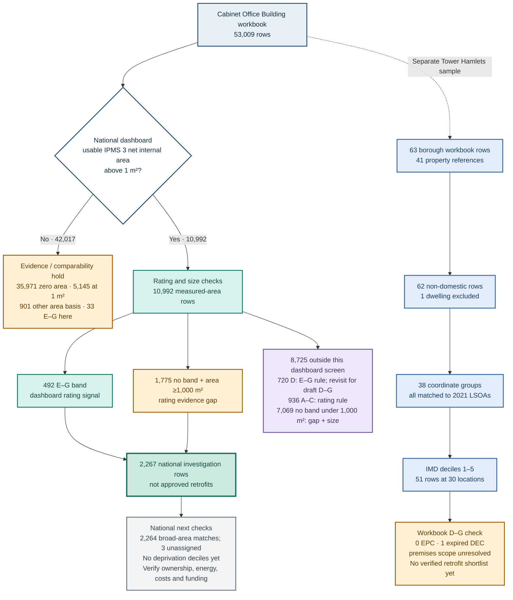

# Estate screening funnel and Tower Hamlets pilot

**Provisional analysis, 20 November 2026.** The decision maker is a public
budget holder seeking candidate publicly owned, non-domestic properties for
funded energy efficiency work. The Cabinet Office workbook reports estate
interests, including leases, so the national register treats public ownership
as an explicit working assumption. These are workbook rows, not confirmed
distinct premises, eligible assets or costed retrofit measures.

[Open the single-page A4 PDF](../analysis/estate-screening-funnel-a4.pdf) ·
[Open the rendered diagram](../analysis/estate-screening-funnel.png)

The solid national path is the **dashboard's applied screen**. Amber boxes
contain missing, suspect or unverified evidence; the purple box separates the
dashboard's current rules from the remaining rating gap. The 33 E–G rows without usable measured area sit
inside the 42,017 held rows. Neither a zero or 1 m² value nor an absent band
proves that a property is unsuitable. The 901 rows measured on another area
basis could be assessed after a documented comparison; their source area
values remain in the workbook.

The five rating-and-size outcomes add to all 10,992 usable measured-area rows:
492 + 1,775 + 720 + 936 + 7,069. The first two outcomes alone produce
2,267 investigation rows. The D-band count identifies a difference between
the existing E–G dashboard and the later draft D–G method; it has **not**
been added to the published dashboard count. The 2,264 county or unitary area
assignments provide broad location, not the small-area geography needed to
assign deprivation deciles. No national deprivation distribution has been
calculated for the 2,267 rows.

The dashed Tower Hamlets route is a **separate selection from the same source
workbook**, not a subset of the 2,267. It applies a borough, non-domestic and
small-area deprivation review. Its 38 coordinate groups can contain more
than one premises. The overall IMD 1–5 rule leaves 51 workbook rows at 30
locations; the one D–G workbook DEC in that group was expired and its
occupied-premises scope is unresolved. Public register checks at Gill Street
found certificate leads, but the workbook-row, area and meter matches remain
unresolved. No measure-level, no-active-investment shortlist has been
verified. The local joins and checks have **not** been applied nationally.

## Provenance and reproduction

- Source: [Cabinet Office Government Property Estate](https://www.data.gov.uk/dataset/a3ad62cf-d8a2-4d3b-b3c6-24c35c5e0f71/the-government-property-estate-including-buildings-and-land), `Building.xlsx`, Building sheet. The downloaded edition, observed on 17 November 2026, is recorded in the [workbook snapshot manifest](workbook-snapshots.json). The original workbook is held in the ignored snapshots directory.
- National screen: [dashboard method and area reconciliation](national-estate-dashboard.md#snapshot-and-screening-method), implemented in [`analysis/build_dashboard_data.py`](../analysis/build_dashboard_data.py). The extra disjoint counts shown here were recounted from all source rows using the same area and rating-band rules on 20 November 2026.
- Tower Hamlets: [estate and geography](tower-hamlets-estate-evidence.md#estate-and-geography), [IMD threshold dry run](uk-public-estate-decarbonisation-method.md#tower-hamlets-threshold-dry-run) and [validation status](tower-hamlets-screening-method.md#verification-status-for-this-draft). Deprivation uses [English indices of deprivation 2025](https://www.gov.uk/government/statistics/english-indices-of-deprivation-2025) on official 2021 LSOAs.
- Draft next-stage rule: [UK public estate decarbonisation method v0.2](uk-public-estate-decarbonisation-method.md#deprivation-and-energy-rating-filters) proposes nation-relative overall deciles 1–5 and separate, current, comparable D–G EPC and DEC checks. It requires site identity, ownership, investment and measure evidence before a funding shortlist.

This diagram contains aggregated counts and method descriptions only. A
separate [public research edition](https://chris-page-gov.github.io/20261120-IREA-Hack-Property-public/)
now pairs it with the reviewed provisional register and source-specific
attribution. The private research repository and its account-linked history
remain separate. Publication does not verify ownership or a funded shortlist.
