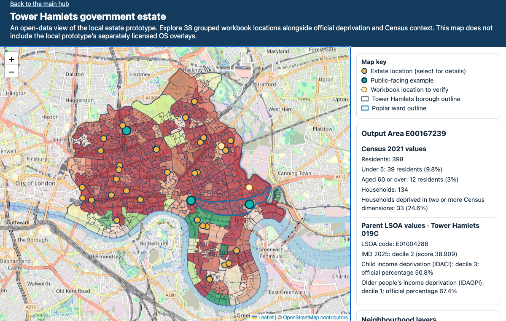
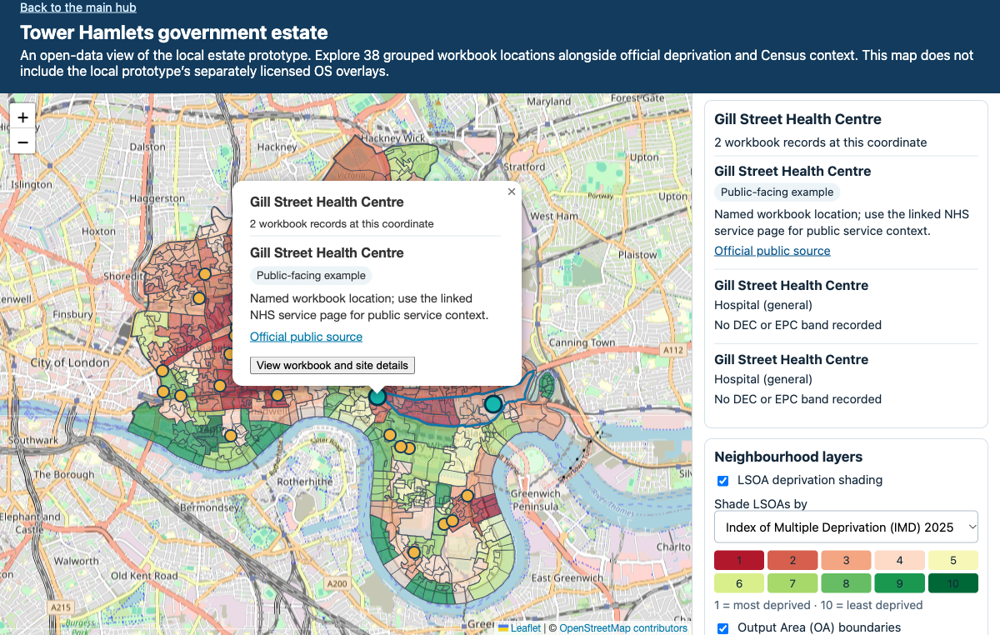
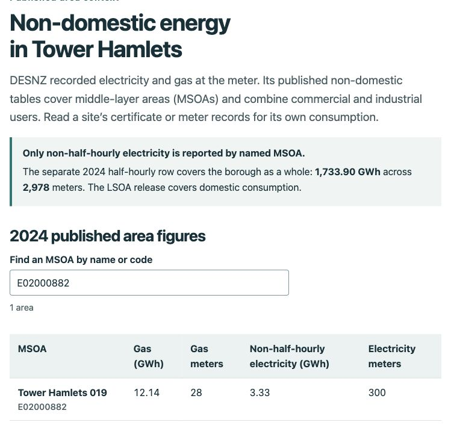
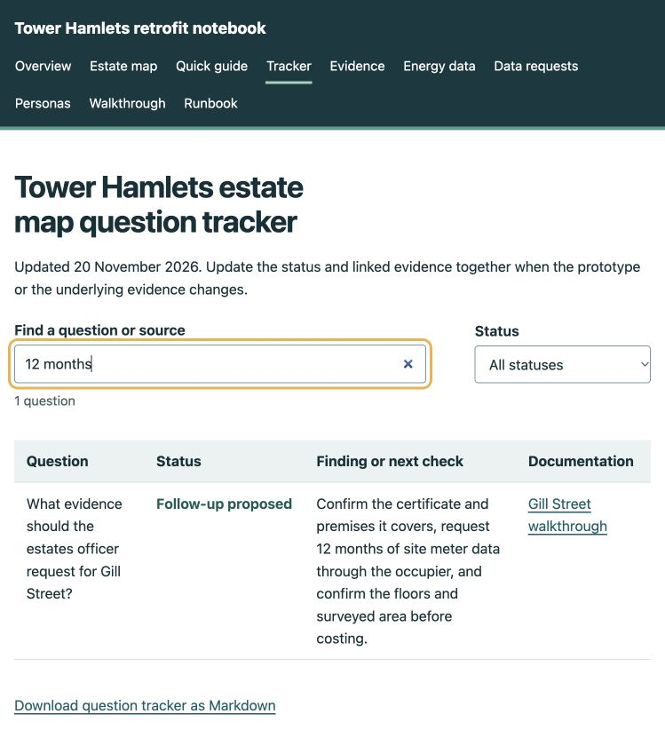

# Gill Street Health Centre evidence walkthrough

A public estates officer is deciding what evidence to request before assessing
retrofit options for Gill Street Health Centre. The screenshots show the
Tower Hamlets Sites companion. The map captures use OpenStreetMap and
retain the visible map attribution. The [personas and user stories](tower-hamlets-personas.md)
describe the proposed role.

## 1. Inspect the neighbourhood

On **Estate map**, choose **Child income deprivation (IDACI)**. Select an Output
Area (OA) and read its Census 2021 figures for children under 5, residents aged
60 and over, and households deprived in at least two Census dimensions.
In the capture, OA E00167239 has 39 residents aged under 5. Its parent
Lower Layer Super Output Area (LSOA), Tower Hamlets 019C, has a 2025 IDACI
decile of 3. Decile 1 indicates the most deprived areas nationally.
Keep both sets of figures at their published geography when describing context.
[Neighbourhood sources](tower-hamlets-estate-evidence.md#neighbourhood-context)

## 2. Check the site and the rating gap

Find **Gill Street Health Centre** and open the linked NHS service listing.
It lists a Healthy Start service at 11 Gill Street, E14 8HQ. The estate
workbook groups two rows at this coordinate. Neither records an EPC or DEC
band. The screenshot shows that workbook snapshot.
[NHS service listing](https://www.nhs.uk/services/service-directory/gill-street-health-centre/N10511522) ·
[Site identity and scope](tower-hamlets-estate-evidence.md#building-identity-and-quantities)

A subsequent public register check on 20 November 2026 found a 2017 asset
EPC and a 2026 operational DEC at the same site address. Confirm which
premises each covers before linking either to a workbook row or comparing
performance. The workbook still records its original blank fields.
[Gill Street register check](tower-hamlets-estate-evidence.md#gill-street-health-centre-public-register-check)

## 3. Read published energy figures at area level

Open **Energy data** and filter for MSOA code `E02000882` to see Tower
Hamlets 019. Use the 2024 DESNZ non-domestic gas and non-half-hourly
electricity figures as Middle Layer Super Output Area (MSOA) context. The
half-hourly electricity figure is published as a borough-wide row. Keep it at
that level. The figures describe area consumption and cannot establish what
Gill Street uses. [Energy evidence and release limits](tower-hamlets-estate-evidence.md#non-domestic-energy-consumption)

## 4. Check the next action in the tracker

Open **Tracker** and search for `12 months` to see the proposed Gill Street
follow-up. Use the row to record the next action in your investigation notes.
The screenshot shows the proposed follow-up before the register check.
Confirm which spaces and meters the two certificates cover and reconcile
their area definitions. Ask the occupier
for 12 months of site meter data by fuel, with meter coverage and shared
supplies identified. Confirm the floors and areas covered by the survey
before costing.
[Question tracker](tower-hamlets-estate-tracker.md) ·
[Evidence to request from occupiers](tower-hamlets-data-access.md#evidence-from-occupiers)

The decision is to request evidence. Current energy performance and retrofit
suitability remain undetermined.
