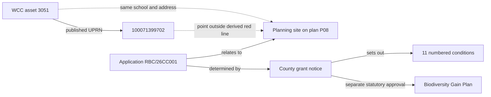

# Avon Valley School, Rugby

Warwickshire County Council's published asset list records the school as
**asset 3051** with **UPRN 100071399702**. The county planning register
records the school extension as **RBC/26CC001**, with permission granted
subject to **11 numbered conditions**. WCC was the determining authority for
this Regulation 3 application.[^asset-register][^planning-register][^decision-notice]

The OS UPRN point is **about 59 m outside the application red line** in
the indicative overlay derived from approved drawing P08. The school
address still links the estate asset to the application. Check the
planning system's source GIS polygon at the Domesday review.[^boundary]

| Follow the evidence | What the record contains |
| --- | --- |
| [Estate asset](avon-valley-school/asset.md) | Source row and tenure value |
| [UPRN](avon-valley-school/uprn.md) | Exact match between the asset list and OS Open UPRN |
| [Planning site](avon-valley-school/site.md) | Approved drawing, plan-derived vector, containment result and source coverage |
| [Application](avon-valley-school/application.md) and [decision](avon-valley-school/decision.md) | Authority, application scope, permission and three separately labelled date fields |
| [Conditions](avon-valley-school/conditions.md) and [biodiversity approval](avon-valley-school/biodiversity.md) | Eleven numbered requirements and the separate approval of the statutory Biodiversity Gain Plan |
| [Machine-readable worked case](avon-valley-school/case.json) | Identifiers, condition records, relationships, source hashes and gaps |

## Walk through on Thursday

1. Open the asset and UPRN records. Check the exact identifier match and
   the 12.1 m difference between the two published reference points in
   British National Grid. Keep both point roles.
2. Open the [boundary check](avon-valley-school/site.md#boundary-and-point-check)
   and its local GeoPackage. The point is outside the georeferenced
   application red line. Compare with the source polygon in WCC's
   planning GIS if available. The drawing also shows a separate blue
   landownership boundary.
3. Read condition 10, which requires drainage verification before occupation.
   Compare it with the separate August approval, which is specific to the
   statutory biodiversity condition.
4. Review the decision date discrepancy. The PDF is dated **3 July 2026**
   and the register records **8 July 2026** as its decision date. It lists
   **9 July 2026** as the extension-of-time date. The case keeps these
   fields separate and leaves the draft public-view issue date unresolved.

This is a local evidence example for the [Domesday review](warwickshire-domesday-review.md).
It uses the planning standard as a working draft. The authoritative register
and signed notice supply the source statements. The authority's public
documents are linked, with hashes of the copies observed during preparation.

[^asset-register]: [WCC February 2026 property and asset list](https://www.warwickshire.gov.uk/directory-record/8957/property-and-asset-list-february-2026).
[^planning-register]: [WCC case register entry for RBC/26CC001](https://planning.warwickshire.gov.uk/swiftlg/apas/run/WPHAPPDETAIL.DisplayUrl?theApnID=RBC%2F26CC001).
[^decision-notice]: [Redacted issued decision notice, pages 1–4 and 7](https://planning.warwickshire.gov.uk/swiftlg/apas/run/WCHDISPLAYMEDIA.showImage?theSeqNo=29034&theApnkey=8411&theModule=1).
[^boundary]: [Approved proposed site plan P08](https://planning.warwickshire.gov.uk/swiftlg/apas/run/WCHDISPLAYMEDIA.showImage?theSeqNo=27604&theApnkey=8411&theModule=1) and [spatial check](avon-valley-school/site.md#boundary-and-point-check).
